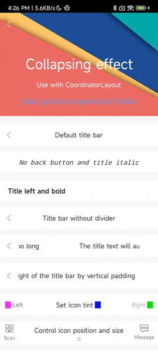
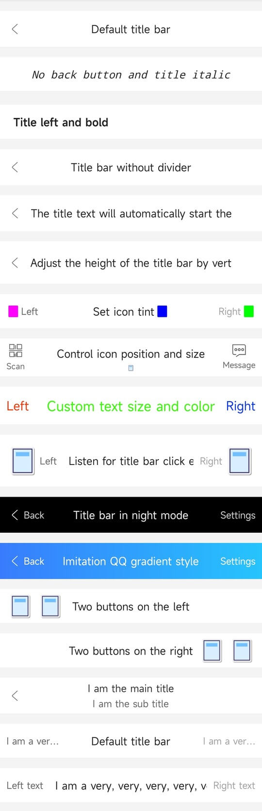

# [中文文档](README.md)

# Title Bar Framework

* Project address: [Github](https://github.com/getActivity/TitleBar)

* [Click here to download demo apk directly](https://github.com/getActivity/TitleBar/releases/download/10.8/TitleBar.apk)



#### Integration Steps

* If your project's Gradle configuration is `below 7.0`, you need to add the following in the `build.gradle` file

```groovy
allprojects {
    repositories {
        // JitPack remote repository: https://jitpack.io
        maven { url 'https://jitpack.io' }
    }
}
```

* If your Gradle configuration is `7.0 or above`, you need to add the following in the `settings.gradle` file

```groovy
dependencyResolutionManagement {
    repositories {
        // JitPack remote repository: https://jitpack.io
        maven { url 'https://jitpack.io' }
    }
}
```

* After configuring the remote repository, add the remote dependency in the `build.gradle` file under the app module

```groovy
android {
    // Support JDK 1.8
    compileOptions {
        targetCompatibility JavaVersion.VERSION_1_8
        sourceCompatibility JavaVersion.VERSION_1_8
    }
}

dependencies {
    // TitleBar framework: https://github.com/getActivity/TitleBar
    implementation 'com.github.getActivity:TitleBar:10.8'
}
```

#### Complete Layout Attributes

* [For xml attribute adaptation of different versions, please click here](Adaptive-en.md)

```xml
<declare-styleable name="TitleBar">

    <!-- Title bar background -->
    <attr name="android:background" />

    <!-- Title bar style -->
    <attr name="barStyle">
        <enum name="light" value="0x10" />
        <enum name="night" value="0x20" />
        <enum name="transparent" value="0x30" />
    </attr>

    <!-- Child view vertical padding (can be used to adjust the adaptive height of the title bar) -->
    <attr name="childVerticalPadding" format="dimension" />

    <!-- Center title -->
    <attr name="title" format="string" />
    <attr name="titleColor" format="reference|color" />
    <attr name="titleSize" format="dimension" />
    <attr name="titleGravity">
        <flag name="left" value="0x03" />
        <flag name="right" value="0x05" />
        <flag name="center" value="0x11" />
        <flag name="start" value="0x00800003" />
        <flag name="end" value="0x00800005" />
    </attr>
    <attr name="titleStyle">
        <flag name="normal" value="0" />
        <flag name="bold" value="1" />
        <flag name="italic" value="2" />
    </attr>
    <attr name="titleIcon" format="reference" />
    <attr name="titleIconWidth" format="dimension" />
    <attr name="titleIconHeight" format="dimension" />
    <attr name="titleIconPadding" format="dimension" />
    <attr name="titleIconTint" format="color" />
    <attr name="titleIconGravity">
        <flag name="top" value="0x30" />
        <flag name="bottom" value="0x50" />
        <flag name="left" value="0x03" />
        <flag name="right" value="0x05" />
        <flag name="start" value="0x00800003" />
        <flag name="end" value="0x00800005" />
    </attr>
    <attr name="titleHorizontalPadding" format="dimension" />
    <!-- Center title text overflow handling mode (marquee enabled by default) -->
    <attr name="titleOverflowMode">
        <enum name="none" value="0" />
        <enum name="start" value="1" />
        <enum name="middle" value="2" />
        <enum name="end" value="3" />
        <enum name="marquee" value="4" />
    </attr>

    <!-- Left title -->
    <attr name="leftTitle" format="string"/>
    <attr name="leftTitleColor" format="reference|color" />
    <attr name="leftTitleSize" format="dimension" />
    <attr name="leftTitleStyle">
        <flag name="normal" value="0" />
        <flag name="bold" value="1" />
        <flag name="italic" value="2" />
    </attr>
    <attr name="leftIcon" format="reference" />
    <attr name="leftIconWidth" format="dimension" />
    <attr name="leftIconHeight" format="dimension" />
    <attr name="leftIconPadding" format="dimension" />
    <attr name="leftIconTint" format="color" />
    <attr name="leftIconGravity">
        <flag name="top" value="0x30" />
        <flag name="bottom" value="0x50" />
        <flag name="left" value="0x03" />
        <flag name="right" value="0x05" />
        <flag name="start" value="0x00800003" />
        <flag name="end" value="0x00800005" />
    </attr>
    <attr name="leftBackground" format="reference|color" />
    <attr name="leftForeground" format="reference|color" />
    <attr name="leftHorizontalPadding" format="dimension" />
    <!-- Left title text overflow handling mode -->
    <attr name="leftTitleOverflowMode">
        <enum name="none" value="0" />
        <enum name="start" value="1" />
        <enum name="middle" value="2" />
        <enum name="end" value="3" />
        <enum name="marquee" value="4" />
    </attr>

    <!-- Right title -->
    <attr name="rightTitle" format="string" />
    <attr name="rightTitleColor" format="reference|color" />
    <attr name="rightTitleSize" format="dimension" />
    <attr name="rightTitleStyle">
        <flag name="normal" value="0" />
        <flag name="bold" value="1" />
        <flag name="italic" value="2" />
    </attr>
    <attr name="rightIcon" format="reference" />
    <attr name="rightIconWidth" format="dimension" />
    <attr name="rightIconHeight" format="dimension" />
    <attr name="rightIconPadding" format="dimension" />
    <attr name="rightIconTint" format="color" />
    <attr name="rightIconGravity">
        <flag name="top" value="0x30" />
        <flag name="bottom" value="0x50" />
        <flag name="left" value="0x03" />
        <flag name="right" value="0x05" />
        <flag name="start" value="0x00800003" />
        <flag name="end" value="0x00800005" />
    </attr>
    <attr name="rightBackground" format="reference|color" />
    <attr name="rightForeground" format="reference|color" />
    <attr name="rightHorizontalPadding" format="dimension" />
    <!-- Right title text overflow handling mode -->
    <attr name="rightTitleOverflowMode">
        <enum name="none" value="0" />
        <enum name="start" value="1" />
        <enum name="middle" value="2" />
        <enum name="end" value="3" />
        <enum name="marquee" value="4" />
    </attr>

    <!-- Divider line -->
    <attr name="lineVisible" format="boolean" />
    <attr name="lineDrawable" format="reference|color" />
    <attr name="lineSize" format="dimension" />

</declare-styleable>
```

#### XML Example

* [Click here to view the complete Demo example](app/src/main/res/layout/activity_main.xml)



#### Set Listener Events

```java
titleBar.setOnTitleBarListener(new OnTitleBarListener() {

    @Override
    public void onLeftClick(TitleBar titleBar) {
        toast("Left View clicked");
    }

    @Override
    public void onTitleClick(TitleBar titleBar) {
        toast("Center View clicked");
    }

    @Override
    public void onRightClick(TitleBar titleBar) {
        toast("Right View clicked");
    }
});
```

#### Unified TitleBar Style

* If you are not satisfied with the default style or attributes of TitleBar, you can intercept and modify them during Application initialization

```java
public class XxxApplication extends Application {

    @Override
    public void onCreate() {
        super.onCreate();

        // Set global style for TitleBar
        TitleBar.setGlobalStyle(new LightBarStyle());
    }
}
```

#### Framework Highlights

* Best performance: does not use LayoutInflater, but creates View by code

* Best experience: TitleBar's default style effect is already very good, you can download the Demo to test

* Supports manipulating child views: you can get the child views of TitleBar in code and call related APIs

* Compatible with immersive status bar: compatible with Github's immersive status bar framework, achieving a fully immersive effect

* Good framework compatibility: this framework does not depend on any third-party libraries and supports all Android versions

* Supports global configuration style: you can initialize the TitleBar style in Application to achieve a once-and-for-all effect

#### Notes

* TitleBar is not born to meet all needs. My original intention is to target some common needs, such as encapsulating a TextView on the left, center, and right. For other situations, it is recommended to customize the layout.

#### Author's Other Open Source Projects

* Android middle office: [AndroidProject](https://github.com/getActivity/AndroidProject)

* Android middle office kt version: [AndroidProject-Kotlin](https://github.com/getActivity/AndroidProject-Kotlin)

* Permissions framework: [XXPermissions](https://github.com/getActivity/XXPermissions)  

* Toast framework: [Toaster](https://github.com/getActivity/Toaster)

* Network framework: [EasyHttp](https://github.com/getActivity/EasyHttp)

* Floating window framework: [EasyWindow](https://github.com/getActivity/EasyWindow)

* Device compatibility framework：[DeviceCompat](https://github.com/getActivity/DeviceCompat)  

* Shape view framework: [ShapeView](https://github.com/getActivity/ShapeView)

* Shape drawable framework: [ShapeDrawable](https://github.com/getActivity/ShapeDrawable)

* Language switching framework: [Multi Languages](https://github.com/getActivity/MultiLanguages)

* Gson parsing fault tolerance: [GsonFactory](https://github.com/getActivity/GsonFactory)

* Logcat viewing framework: [Logcat](https://github.com/getActivity/Logcat)

* Nested scrolling layout framework：[NestedScrollLayout](https://github.com/getActivity/NestedScrollLayout)  

* Android version guide: [AndroidVersionAdapter](https://github.com/getActivity/AndroidVersionAdapter)

* Android code standard: [AndroidCodeStandard](https://github.com/getActivity/AndroidCodeStandard)

* Android resource summary：[AndroidIndex](https://github.com/getActivity/AndroidIndex)  

* Android open source leaderboard: [AndroidGithubBoss](https://github.com/getActivity/AndroidGithubBoss)

* Studio boutique plugins: [StudioPlugins](https://github.com/getActivity/StudioPlugins)

* Emoji collection: [EmojiPackage](https://github.com/getActivity/EmojiPackage)

* China provinces json: [ProvinceJson](https://github.com/getActivity/ProvinceJson)

* Markdown documentation：[MarkdownDoc](https://github.com/getActivity/MarkdownDoc)  

## License

```text
Copyright 2018 Huang JinQun

Licensed under the Apache License, Version 2.0 (the "License");
you may not use this file except in compliance with the License.
You may obtain a copy of the License at

   http://www.apache.org/licenses/LICENSE-2.0

Unless required by applicable law or agreed to in writing, software
distributed under the License is distributed on an "AS IS" BASIS,
WITHOUT WARRANTIES OR CONDITIONS OF ANY KIND, either express or implied.
See the License for the specific language governing permissions and
limitations under the License.
```
